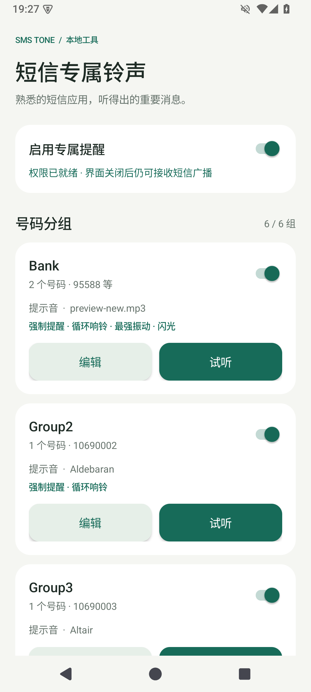
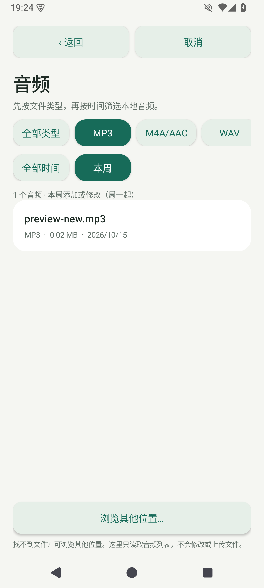

# 短信专属铃声 · SmsTone

**熟悉的短信应用，听得出的重要消息。**

你是否也曾因错过或忽略一条重要短信而懊恼？也许是一张本可避免的罚单，也许是某个重要的人留给你的消息。SmsTone 帮你为重要号码设置专属声音，并按需开启闹钟式强制提醒，让重要短信更容易被注意到。

这是一款由 AI 编写、人工提出需求并迭代验证的安卓开源小工具。保留手机默认短信应用，专注于重要号码的声音提醒。使用 MIT 许可，独立实现，没有复制 QUIK 代码，没有第三方运行时依赖，也没有联网权限。

**当前发布：0.3.0 测试版 · Android 8.0 及以上 · 仅支持 Android，暂无 iOS 版本。**

## 下载与安装

从 [0.3.0 发布页](https://github.com/ceoxul-maker/SmsTone/releases/tag/v0.3.0) 下载 [SmsTone-0.3.0.apk](https://github.com/ceoxul-maker/SmsTone/releases/download/v0.3.0/SmsTone-0.3.0.apk)，传到手机后安装。普通使用者无需下载源码或安装开发工具。

- 安装时按系统提示允许当前浏览器或文件管理器安装应用。
- 已装同签名测试版的用户可直接覆盖安装保留设置；不要先卸载，否则规则和导入音频会清除。
- 本次只发布 0.3.0 源码及安装包，不提供此前版本。
- 发布包附有 `SHA256-0.3.0.txt`，可校验文件完整性。

## 可以做什么

| 功能 | 说明 |
| --- | --- |
| 最多 6 组号码 | 每组可放多个完整来源号码，分别配置声音与提醒方式 |
| 系统铃声 / 本地音频 | 支持系统可解码的 MP3、M4A、WAV 等，单文件最多 20 MB |
| 普通提醒 | 跟随系统通知音量、静音和勿扰设置 |
| 可选强制提醒 | 使用最大闹钟音量循环播放，直到手动停止；可叠加振动、闪光 |
| 完整效果试听 | 首页独立“编辑”“试听”；编辑页“保存并试听”应用整套设置 |
| 音频优先选择 | 默认音频列表，支持文件类型与“本周”筛选，随时返回或取消 |
| 保留原短信应用 | 点按普通提醒，或停止强提醒后，打开系统默认短信应用查看内容 |

## 界面预览

以下为 Android 15 模拟器截图，号码和音频文件为测试样例。

  
  

## 第一次使用

1. 允许接收短信及发送通知，然后打开应用总开关。
2. 添加号码组：填写组名和完整来源号码，每行一个，也可用中英文逗号或分号分隔。重复号码会被拒绝；不按尾号、前缀或短信正文匹配。
3. 选择系统铃声或本地音频。媒体库没有列出文件时，使用“浏览其他位置”；不授权音频库也可通过系统文件选择器选取单个文件。
4. 按需打开“强制提醒”、振动、闪光。强制试听会实际以最大闹钟音量循环，请准备手动停止。
5. 保存后点“试听”，或在编辑页点“保存并试听”。普通试听在静音时会提示原因；强制试听会执行已保存的声音、振动和闪光设置，结束后恢复原闹钟音量。
6. 在手机设置中搜索“自启动”“应用启动管理”“后台活动”“电池优化”，允许工具后台运行。不同品牌和系统版本入口不同，以手机实际菜单为准。
7. 如需锁屏全屏提醒，在应用提供的设置入口中授权；在勿扰设置中允许闹钟。最后用一条真正的短信验证后台接收。

每组和总开关都可独立控制。手动试听也可测试已停用的组，不会自动开启组或总开关。若原短信应用支持会话单独静音，可关闭目标会话的原声音，避免双响；不要关闭整个短信应用的通知，以免其他号码失去提醒。

## 隐私与权限

应用业务代码只使用新短信的**来源号码**匹配提醒，不调用正文读取接口，不提取、展示、保存或上传短信正文，也不读取历史短信。Android 的短信接收权限会将新短信事件交给应用；其中仅取来源号码用于匹配，短信内容依然在默认短信应用查看。

应用没有 `INTERNET` 权限，没有广告、分析或联网 SDK。规则、导入音频、音量恢复记录和最近一次匹配结果保存在本机，已禁用应用云备份。详见 [隐私与权限说明](docs/PRIVACY.md)。

| 权限 / 设置 | 用途 |
| --- | --- |
| 接收短信 | 收到新 SMS 后匹配来源号码；不申请历史短信读取或发送短信权限 |
| 通知 | 显示提醒状态及停止入口；通知被关闭时不启动强制提醒 |
| 音乐和音频 / 旧版存储读取 | 列出系统已索引的本地音频；可拒绝并改用单文件选择 |
| 相机（可选） | 仅通过手电筒接口闪光，不打开相机、不拍照或录制 |
| 全屏提醒、忽略电池优化（按需） | 锁屏提醒和后台运行，需用户在系统设置中允许 |
| 前台媒体播放、振动、音量调整、唤醒锁、开机接收 | 持续提醒、控制效果，并在重启解锁后恢复已记录的音量 |

## 使用边界

- **强制提醒可在普通静音下使用闹钟音频通道，但不能保证绕过完全勿扰、禁止闹钟、厂商后台拦截或强行停止。** 本工具不修改全局勿扰策略，请允许闹钟，并在自己的手机上测试。
- 最强振动请求振幅 255，实际强度取决于手机硬件。闪光需设备支持、相机权限和手电筒未被占用，系统后台策略也可能限制它。
- 只处理运营商普通 SMS，不处理 RCS、彩信或聊天软件消息。受系统保护的部分验证码 / WebOTP / SMS Retriever 消息可能无法及时交付。
- 多组强提醒不会叠加：新的组替换当前声音及效果；同组连续短信不重启当前播放。停止后恢复触发前的闹钟音量。
- 系统异常强杀可能无法立即恢复音量。重新打开应用或重启解锁后，会恢复已记录的旧音量，不会自动重新响铃。
- 自选音频不可用时尝试系统闹钟音；均不可用时显示错误，仍可手动结束可用的振动或闪光。
- 声明最低 Android 8.0；目前已完成 Android 15 AOSP 模拟器测试，尚未完成各品牌真机兼容验证。不能替代系统闹钟或紧急告警设施。

## 开发、测试与问题反馈

使用 Java 原生 Android API，不依赖 Gradle。构建需要 JDK 17、Android API 35 和 build-tools 35.0.0，详见 [构建与验证](docs/BUILDING.md)。当前安装包 target SDK 为 34，具体缘由及验证范围也在该文档中说明。

已通过 40 条号码、分组、音频筛选边界测试，以及 Android 15 模拟器的完整效果试听、短信触发、停止恢复音量、默认短信跳转等检查。模拟器验证不等于真机兼容承诺。

反馈问题时请提供应用版本、手机型号、Android / 系统版本、操作步骤及预期结果。请勿提交真实短信正文、完整私人号码、验证码或签名密钥。

## 许可

[MIT License](LICENSE)。欢迎检查代码、报告问题和提出改进。Android 权限与系统行为依据：[短信广播](https://developer.android.com/reference/android/provider/Telephony)、[前台服务](https://developer.android.com/develop/background-work/services/fgs/service-types)、[音频焦点](https://developer.android.com/media/optimize/audio-focus)、[手电筒接口](https://developer.android.com/reference/android/hardware/camera2/CameraManager#setTorchMode(java.lang.String,boolean))。
